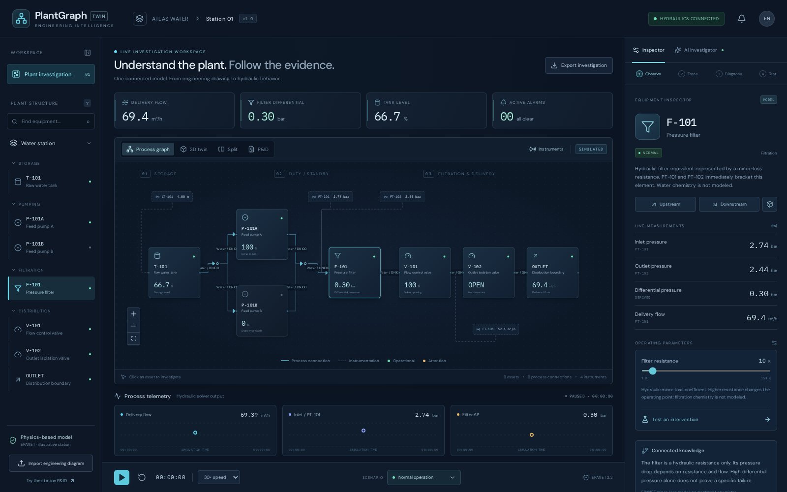

# PlantGraph Twin

**Turn an engineering drawing into a traceable plant graph. Investigate the symptoms. Test a response with physics.**

PlantGraph Twin is a local engineering investigation prototype for a water pumping, filtration and distribution station. A process graph, P&ID, procedural 3D station, live sensor traces and AI investigator share the same equipment identities.



## Run the presentation

Prerequisites: Linux/macOS, Node.js 22+, npm, and [uv](https://docs.astral.sh/uv/). Python 3.12 is installed by the setup script.

```bash
./scripts/setup.sh
# Set ANTHROPIC_API_KEY in .env with your own credential.
./scripts/present.sh
```

Open **http://127.0.0.1:8000**. The six-slide pitch deck is at **http://127.0.0.1:8000/presentation**; API documentation is at **http://127.0.0.1:8000/docs**. To work on the frontend with live reload, run `./scripts/dev.sh` and open http://127.0.0.1:5173 instead. Use one launcher at a time.

The application starts with a working solver-backed station even without AI access. Diagram extraction and the copilot make real paid Anthropic requests when a credential is configured; failures are shown explicitly. There is no simulated AI fallback.

Configuration:

```dotenv
ANTHROPIC_API_KEY=your-local-credential
ANTHROPIC_MODEL=claude-sonnet-5-5
```

Credentials remain on the server. `.env`, uploaded images, and generated runtime data are ignored by Git. Never put a credential in frontend configuration.

## What works

- **Diagram understanding:** upload a PNG/JPEG, or use a supplied example. Claude extracts tagged equipment, process connections, instruments, source bounds and uncertainties. The engineer can correct the candidate before accepting it.
- **Plant knowledge graph:** distinguish physical pipes, instrument signals, documented equipment rules, observed readings, and diagnostic hypotheses. Select equipment, trace upstream/downstream paths, and inspect its source region.
- **Hydraulic station:** EPANET 2.2 through WNTR solves the actual operating point. Two parallel duty/standby pumps, a finite tank, filter resistance, control and isolation valves, and a downstream-head boundary.
- **Interactive 3D:** orbit, zoom, focus, camera presets, clickable equipment, water level, computed flow animation, equipment status, alarm highlighting and filter pressure evidence. The layout is illustrative, not a surveyed facility.
- **Frozen v1 incident:** filter restriction, with normal operation for comparison. Speed, duty selection and valve/filter controls change real model parameters. Additional scenarios remain backend regression cases outside the presentation workflow.
- **What-if comparison:** solve an intervention from the same current inventory without changing the operating station. Compare delivery, head and differential pressure. Ask Claude to interpret server-recomputed results.
- **Grounded copilot:** uses topology, recent measurements and documented rules. The diagnostic context excludes the injected scenario identity and latent failure parameters. Explanations remain hypotheses, with evidence and proposed experiments.
- **Evidence export:** download a JSON investigation record with the plant, current state, extraction, rules and comparison.

## A repeatable demo

1. Inspect the process graph and select **F-101**. Trace upstream and downstream.
2. Open **P&ID** and choose **Extract station with Claude**. Review the equipment and connections, then confirm. The accepted topology must match the supported hydraulic template before readings are bound.
3. Play the simulation, then inject **Filter restriction**. Delivery falls from about **69.39 to 52.48 m³/h**, while filter differential rises from **0.301 to 1.377 bar** at the initial tank level.
4. Open the **3D twin**. Select the filter and examine the pressure evidence and connected inspector.
5. Ask the AI investigator why delivery fell and which experiment distinguishes a filter issue from a pump issue.
6. Run the clean-filter intervention and compare the predicted recovery without changing the operating station.
7. Export the investigation, then reset to baseline.

See [the five-minute demo script](docs/demo-script.md) for presentation wording and questions.

[Watch/download the recorded complete workflow](artifacts/demo.webm). It uses genuine Claude image extraction and investigation plus actual EPANET results; no responses or readings are mocked.

## Engineering and data honesty

This is a **representative simulation twin**, not a field-calibrated utility asset. Physical parameters are illustrative and documented. The original P&ID, hydraulic topology and 3D scene describe the same demonstration station. No language model calculates pressures or invents telemetry.

A public Utah water-facility design and a CADXChange heating-system sample are used as independent extraction tests. Unfamiliar or incomplete equipment remains reviewable as a graph but cannot silently inherit this station's measurements or geometry. The Utah drawing requires an optional download because its redistribution license has not been established:

```bash
.venv/bin/python scripts/download_references.py --public-water
```

BATADAL/C-Town files are included as optional external benchmark references. They are simulation-generated and are **not** claimed to match the custom filtration station. [Data provenance and attribution](docs/data-sources.md).

## Test

```bash
PYTHONPATH=backend .venv/bin/pytest backend/tests -q
cd frontend
npm run build
npx playwright install chromium
# Start the dev launcher in another terminal first.
npm run test:e2e
# Optional: includes paid image extraction and copilot requests.
LIVE_AI=1 npm run test:e2e
```

The tests cover hydraulic responses, mass balance, interlocks, timing, input validation, pure comparisons, graph binding, diagnostic context, UI controls, graph/3D selection, export and optional live AI integration. Test results and presentation evidence are recorded in [validation.md](docs/validation.md): **43 backend tests and 10 production-browser tests passed**, including live Anthropic requests. A complete recorded rehearsal is available at `artifacts/demo.webm`.

## Architecture and limits

React 19 / TypeScript / React Flow / React Three Fiber / Three.js / Recharts frontend. FastAPI / Pydantic / NetworkX backend. WNTR 1.5 / EPANET 2.2 hydraulic engine. Anthropic Python SDK with **Claude Sonnet 5.5 (`claude-sonnet-5-5`)** for image extraction and engineering explanations. No model training is required.

One local shared session, in-memory history and review state, local image uploads. Restart clears session state. Quasi-steady hydraulics with finite tank integration; no CFD, water hammer, treatment chemistry or automated control of real hardware. General P&ID-to-simulation generation would require additional equipment models and engineering parameters.

- [Architecture](docs/architecture.md)
- [Hydraulic equations and parameters](docs/hydraulic-model.md)
- [Data sources](docs/data-sources.md)
- [API contract](docs/contract.md)

Original code and station drawing are MIT licensed. Third-party references retain their own terms. Claude is a proprietary model: this Anthropic-only configuration does not satisfy a challenge requiring Gemma 4 or central open-weight AI, even though the application code is open source.
