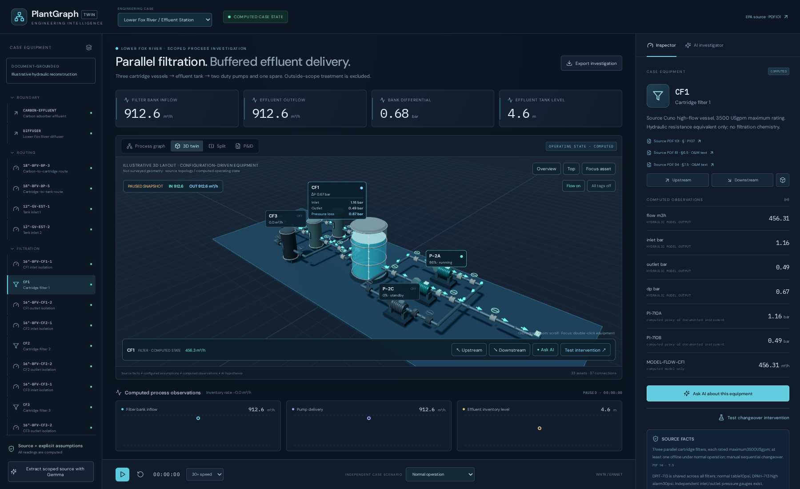

# PlantGraph Twin

PlantGraph Twin helps an engineer understand a water plant, investigate a problem and calculate whether an intervention would help.

It connects an engineering drawing, an equipment graph, an interactive 3D plant, hydraulic calculations and an AI investigator in one workspace.



## The problem

Engineers often have to move between drawings, equipment lists, measurements and operating instructions to understand a plant problem. These sources can be difficult to connect, especially when a problem affects equipment farther along the process.

PlantGraph Twin brings those relationships together. An engineer can select equipment, follow the water path, inspect calculated measurements, compare possible causes and test a response before changing the operating simulation.

## How it works

1. Load a supported engineering drawing.
2. Ask AI to identify equipment, tags and connections.
3. Review the candidate graph and resolve missing or uncertain information.
4. Explore the same equipment in the graph, drawing and 3D scene.
5. Run normal operation and introduce a selected problem.
6. Inspect pressures, flows, tank inventory, equipment states and alarms.
7. Ask AI for hypotheses supported by the available evidence.
8. Calculate an isolated intervention and compare it with the operating state.

The engineer reviews the AI output. Graph validation checks compatibility. EPANET calculates the hydraulics. AI explains evidence and uncertainty rather than inventing pressures or flow rates.

## Two supported cases

### Atlas Water

Atlas is an original representative station with one tank, two pumps, one filter, two valves and a distribution boundary. One pump operates while the other is on standby.

The main investigation introduces filter restriction. The engineer can observe increased differential pressure and reduced delivery, inspect the connected equipment and compare a clean filter intervention.

### Lower Fox River

This case uses the actual Lower Fox River Water Treatment Plant Operation and Maintenance Plan hosted by the EPA. The modeled section contains three cartridge filters, an effluent tank, three effluent pumps, associated valves and discharge boundaries.

The source is [EPA document 376921](https://semspub.epa.gov/work/05/376921.pdf). The normal operation drawing is P107 on PDF page 101. Sections 6.5, 6.6 and 8 describe filtration, effluent pumping and troubleshooting.

Two independent investigations start from the same normal conditions. Filter fouling reduces tank inflow first, while stored water can maintain initial delivery. Pump degradation reduces discharge first, causing tank inventory to rise. The engineer can compare filter changeover or replacement with the healthy standby pump.

The source does not provide every physical parameter. Missing pump curve points, hydraulic boundaries, pipe properties, elevations and controller gains are documented assumptions. The source drawing supports equipment and connectivity, not surveyed 3D geometry.

## Explore the workspace

Click an equipment mesh or label to select it. Double click to focus the camera. Drag to orbit and scroll to zoom. Selection connects the graph, source drawing, inspector and 3D plant.

Directional arrows show calculated water flow. Inactive branches have no flow animation. Pausing playback freezes animation. Tank water level, pressure readings and computed warnings remain visible.

Upstream and downstream tracing helps explain propagation. Ask AI and Test intervention are available from the equipment workspace. Predictions are shown separately and do not change the operating simulation.

## Run locally

Use Linux or macOS with Node.js 22 or newer, npm and uv installed. The setup script installs Python 3.12 and the project dependencies.

```bash
./scripts/setup.sh
```

Open the local `.env` file and configure your Google credential.

```dotenv
GOOGLE_API_KEY=your_google_api_key
```

The example configuration selects Gemma 4 26B A4B IT through the Gemini API. The exact API model identifier is in `.env.example` and can be changed with the backend `GEMMA_MODEL` setting.

```bash
./scripts/present.sh
```

Open http://127.0.0.1:8000 for the application, http://127.0.0.1:8000/docs for the API reference and http://127.0.0.1:8000/presentation for the presentation slides.

For frontend development, use `./scripts/dev.sh` and open http://127.0.0.1:5173. Use one launcher at a time.

Credentials are read by the backend. They must never appear in frontend configuration, screenshots, logs or committed files. The local `.env` file is ignored by Git.

## Screenshots

Open the [local screenshot gallery](artifacts/submission/index.html) to browse both workflows at full resolution.

[Normal operation](artifacts/submission/normal/) contains the source designs, engineering graphs, normal 3D plants and available extraction review views.

[Problem investigation](artifacts/submission/problematic/) contains fault evidence, connected equipment, AI explanations and calculated intervention comparisons.

The application is configured for Gemma 4. AI screenshots captured with the temporary Claude Sonnet 5.5 environment retain their visible Claude attribution and are identified in the capture manifest. Those screenshots are not evidence of Gemma responses. The temporary recording environment is separate from the submitted application configuration.

## Technologies

The frontend uses React 19, TypeScript, Vite, React Flow, React Three Fiber, Three.js and Recharts.

The backend uses Python 3.12, FastAPI, Pydantic and NetworkX. WNTR 1.5 and EPANET 2.2 solve the hydraulic operating points. Tank inventory is calculated from inflow and outflow over time.

Gemma 4 through the Google Gemini API interprets engineering images and explains supplied evidence. Pydantic validates generated JSON. The engineer reviews topology before it can be bound to the supported hydraulic model. Provider errors are shown explicitly and no automatic provider fallback is used.

## Tests and limitations

```bash
PYTHONPATH=backend .venv/bin/pytest backend/tests
cd frontend
npm run build
npm run test:e2e
```

The backend suite currently passes 91 tests. The latest full browser run passed 22 of 23 checks. The remaining check encountered a Google rate limit during the Lower Fox investigation. Request context has since been reduced and bounded quota retries added. That complete live Gemma workflow must be verified again before claiming it passes.

All operational readings are generated by the hydraulic solver. Neither case replays a recorded utility incident. No Atlas or BATADAL readings are assigned to Lower Fox. Source facts, assumptions, calculated observations and AI hypotheses remain separate.

This is a local engineering prototype with one shared session. It is not a calibrated utility twin, a construction design, a water quality model or a system controlling real equipment. General simulation of arbitrary uploaded diagrams is not supported. Compatible equipment templates and reviewed engineering parameters are required.

The [documentation folder](docs/) contains architecture, source attribution, hydraulic assumptions, validation results, demo instructions and submission status.

## Repository structure

`frontend` contains the interface, graphs, 3D equipment and browser tests.

`backend` contains the API, plant configurations, hydraulic services, AI integration and backend tests.

`data` contains supported drawings, source metadata, model inputs and external references.

`docs` contains engineering explanations and presentation material.

`artifacts/submission` contains the organized screenshot evidence.

`scripts` contains setup, startup, source retrieval and packaging tools.

## License and submission

Original application code and the Atlas drawing use the MIT license. External engineering drawings and datasets retain their own rights and attribution. EPA hosting does not mean a contractor drawing is public domain.

This repository contains the source code and screenshot evidence for publication. Event submission is a separate step. A working application or qualifying model integration alone does not establish hackathon eligibility. The organizer also requires the repository, license, evidence and submission within its deadline.
