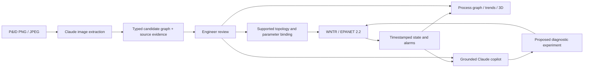

# Architecture

PlantGraph Twin is a local, single-session engineering investigation application. The FastAPI server owns simulation state and the Anthropic credential. The React application owns presentation and linked selection. Every reading originates in an explicit EPANET solve.

## Information contract

Assets retain the same IDs in the P&ID, graph, model mapping, controls, scene and explanation. Process connectivity and instrument signals are separate edge types. Pump/valve symbols become links in EPANET; the equipment investigation graph represents them as nodes. The mapping is explicit rather than treating those two graph representations as interchangeable.

`GET /api/plant` returns the original plant configuration. `GET /api/state` and operator events settle elapsed simulation time if playing; AI reads never advance the session. History is bounded to 300 snapshots. Controls and scenario requests solve a new hydraulic operating point. `POST /api/what-if` solves a detached comparison from the same inventory and leaves the session untouched.

Diagram extraction returns a candidate, not an automatically accepted physical model. The original, expected topology validates asset types, required paths, missing endpoints and unsupported bypasses. Review records the actual edited candidate. An incompatible diagram can be investigated as a graph, but is not attached to the example station's readings.

## AI boundaries

The backend calls `claude-sonnet-5-5` using the Anthropic Python SDK, with the model configurable via `ANTHROPIC_MODEL`. Structured output enforces a typed response; semantic validation remains necessary. Embedded drawing instructions are treated as untrusted document content. Maximum upload size is 10 MB and images are converted to canonical PNG.

Diagnostic prompts contain topology, explicit engineering rules, timestamped readings and observable operator settings. They exclude scenario names and latent health/resistance/leak settings. Hypotheses and qualitative confidence are not validated root causes or calibrated probabilities. What-if numbers come exclusively from the hydraulic solver.

No browser bundle contains credentials. `.env`, uploaded drawings and generated runtime artifacts are ignored by Git. The app binds to loopback by default. This prototype has one shared session and no user authentication; it is intended for a local demonstration.

## Runtime

Python 3.12 and pinned requirements; Node.js 22+ with the committed npm lockfile. Development uses Vite's proxy to FastAPI. Presentation builds the frontend and serves it from FastAPI at one origin. API schemas and interactive documentation are exposed at `/docs`.
