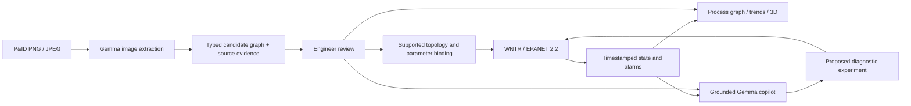

# Architecture

PlantGraph Twin is a local, single-session engineering investigation application. The FastAPI server owns simulation state and the Google API credential. The React application owns presentation and linked selection. Every operating reading originates in an explicit EPANET solve or tank inventory calculation.

## Information contract

Assets retain the same IDs in the P&ID, graph, model mapping, controls, scene and explanation. Process connectivity and instrument signals are separate edge types. Pump/valve symbols become links in EPANET; the equipment investigation graph represents them as nodes. The mapping is explicit rather than treating those two graph representations as interchangeable.

`GET /api/plant` returns the selected case configuration. `GET /api/cases` lists cases and `POST /api/cases/select` resets the selected operating case. The UI unmounts the old workspace before switching, clearing incompatible selections, histories, reviews, conversations and predictions. `GET /api/state` and operator events settle elapsed simulation time if playing; AI reads never advance the session. History is bounded to300 snapshots. Controls and scenario requests solve a new hydraulic operating point. Atlas uses `POST /api/what-if`; Lower Fox uses `POST /api/cases/what-if` for declared filter/pump changeovers. Detached comparisons retain the same initial inventory/controller state and leave the session untouched.

Diagram extraction returns a candidate, not an automatically accepted physical model. The original, expected topology validates asset types, required paths, missing endpoints and unsupported bypasses. Review records the actual edited candidate. An incompatible diagram can be investigated as a graph, but is not attached to the example station's readings.

Lower Fox's source-reviewed configuration in `lower_fox.py` defines three filter and three pump branches, associated valves, boundaries and sensors, with shared constants/parameters for hydraulic construction. Its assets and links generate the generic graph and procedural3D templates. The original Atlas renderer is retained for regression. Explicit source augmentation during review displays changed equipment/links, preserves raw Gemma output and does not claim those additions were AI-extracted. A compatible reviewed graph inherits canonical layout/source metadata; arbitrary topology changes are rejected instead of silently solved by a different network.

Lower Fox state uses generic `metrics`, `asset_values`, `readings`, equipment states and controls. It contains no Atlas measurement keys. Documented instrument proxies and model-only branch flows carry distinct computed provenance. A shared differential does not localize a blocked cartridge. The finite tank separates filter inflow from pump discharge; inventory integration and an explicitly illustrative linked-VFD PI controller determine the time response. Source low-flow/low-low trips latch. The model-only inventory warning is separate from documented PLC alarms.

## AI boundaries

The backend calls actual Gemma 4 through the Google Gemini API using google-genai. GEMMA_MODEL defaults to gemma-4-31b-it; the live demonstration may explicitly configure gemma-4-26b-a4b-it when 31B service is unavailable. Responses are prompted as JSON and validated with Pydantic; there is no native schema guarantee and no other-provider fallback. Gemma image bounds on a 0–1000 coordinate scale are explicitly converted to the existing normalized 0–1 application contract. Embedded drawing instructions are treated as untrusted document content. Maximum upload size is 10 MB and images are converted to canonical PNG.

Diagnostic prompts contain topology, explicit engineering rules, timestamped readings and observable operator settings. They exclude scenario names and latent health/resistance/leak settings. Hypotheses and qualitative confidence are not validated root causes or calibrated probabilities. What-if numbers come exclusively from the hydraulic solver.

No browser bundle contains credentials. `.env`, uploaded drawings and generated runtime artifacts are ignored by Git. The app binds to loopback by default. This prototype has one shared session and no user authentication; it is intended for a local demonstration.

## Runtime

Python 3.12 and pinned requirements; Node.js 22+ with the committed npm lockfile. Development uses Vite's proxy to FastAPI. Presentation builds the frontend and serves it from FastAPI at one origin. API schemas and interactive documentation are exposed at `/docs`.
